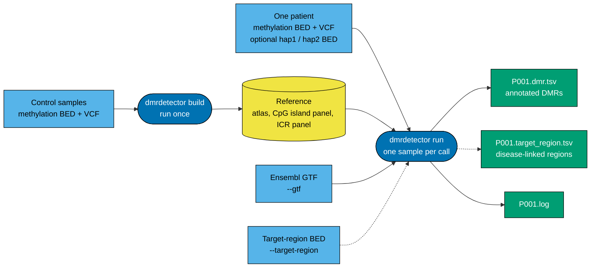

# DMRdetector

[](CHANGELOG.md)
[](LICENSE)
[](#install)
[](#install)
[](https://doi.org/10.5281/zenodo.18978867)

> **Version used in the manuscript: DMRdetector v2.2** (R and Nextflow), [release `v2.2-manuscript`](https://github.com/oumarkme/DMRdetector/releases/tag/v2.2-manuscript) (git tag `v2.2-manuscript`, commit `364f242`). All results, figures and tables of Ou, Tsai et al. (2026) come from that code, with Ensembl release 86 and the 69-control atlas on [Zenodo](https://doi.org/10.5281/zenodo.18978867). To reproduce the manuscript, download that release or check out its tag. This page describes version 3.2.0, a Python rewrite with the same algorithm and parameters; the stage-by-stage comparison with v2.2 is in [doc/validation.md](doc/validation.md).

DMRdetector finds differentially methylated regions (DMRs) in a single patient from long-read methylation data (Oxford Nanopore Technologies, ONT, or PacBio). The tool tests CpG islands and imprinted control regions (ICRs) against a reference atlas built from control samples. It reports each DMR with its gene, direction, methylation difference and false discovery rate (FDR). The target users are bioinformaticians who analyze rare-disease and imprinting-disorder cases one sample at a time.

- One sample per call. `build` makes the reference once from controls; `run` tests one sample against it.
- Inputs: ONT modkit bedMethyl, PacBio pb-CpG-tools, or a plain 5-column BED, plus a VCF for the heterozygous-SNP filter. hg38/GRCh38 only.
- Optional report on 21 disease-linked hg38 regions (imprinting disorders, uniparental disomy loci, *DMPK*), with direction and per-haplotype tracks.
- One locked container image (Apptainer or Docker) is the reference environment; a pip installation is possible (see Install). Linux x86_64 and WSL2 only.

## How it works



Solid arrows are required, dashed arrows are optional. Per CpG, the method removes sites on heterozygous SNPs, filters by coverage, estimates a Beta-Binomial dispersion with shrinkage, and smooths the atlas by Gaussian convolution (sigma = 150 bp). Each CpG island or ICR gets a one-sample t-test against the atlas with Benjamini-Hochberg correction. [doc/ALGORITHM.md](doc/ALGORITHM.md) lists every step and parameter.

## Install

Supported: Linux x86_64 and WSL2. macOS, ARM Linux and native Windows are not supported ([doc/usage.md](doc/usage.md)).

### pip

The package installs into a virtual environment (Python 3.12 only; `pyproject.toml` excludes 3.13 and later because only 3.12 was run). pip takes numpy, scipy, pandas, pysam and numba from the ranges in `pyproject.toml`, the minor series of the versions in `env/requirements.lock`.

```bash
python -m venv venv
venv/bin/pip install .          # in the repository root
venv/bin/pip install git+https://github.com/oumarkme/DMRdetector.git     # or from git
venv/bin/dmrdetector --version
```

To install exactly the locked versions, install the lock first and then the package without dependencies:

```bash
venv/bin/pip install --require-hashes --only-binary=:all: -r env/requirements.lock
venv/bin/pip install --no-deps .
```

The container stays the reference environment. Only the image fixes the interpreter, the packages, the compiled kernels, libdeflate and `GLIBC_TUNABLES=glibc.cpu.hwcaps=-FMA,-FMA4`, so only the image guarantees identical output across machines ([doc/dependencies.md](doc/dependencies.md)). Outside the image, export `GLIBC_TUNABLES` as above before the command starts; the program cannot set it itself, because glibc reads it at process start. In the Quick start, call `venv/bin/dmrdetector` where the shell function is used.

### Container

There is no prebuilt image to download. Build the image yourself from `env/dmrdetector.def` (Apptainer) or `env/Dockerfile` (Docker), or use the pip route above. You need Apptainer 1.x ([install guide](https://apptainer.org/docs/admin/main/installation.html)) or Docker, and a network connection for the build. Build the image once (4 to 9 minutes depending on server load; 168 MB):

```bash
git clone https://github.com/oumarkme/DMRdetector.git
cd DMRdetector
apptainer build --fakeroot dmrdetector.sif env/dmrdetector.def
apptainer exec dmrdetector.sif dmrdetector --version      # dmrdetector 3.2.0
```

A release build adds the strict cache option, which makes the build fail when the compiled kernels cannot be baked into the image (`apptainer build --fakeroot --build-arg REQUIRE_CACHE=1 dmrdetector.sif env/dmrdetector.def`; for Docker, `docker build -f env/Dockerfile --build-arg DMRDETECTOR_REQUIRE_CACHE=1 -t dmrdetector:3.2.0 .`). Problems with `--fakeroot`, Docker and Singularity, and the numba cache are in [doc/usage.md](doc/usage.md). Apptainer mounts your home directory, `/tmp` and the current directory; add other data folders with `--bind`. A shell function keeps the commands below short:

```bash
SIF=$PWD/dmrdetector.sif
dmrdetector() { apptainer exec "$SIF" dmrdetector "$@"; }
```

## Quick start

The repository writes a small synthetic data set (8 controls, 2 cases on chr22, chrX and chrY), so that every command below runs as written. The thresholds in the demo `settings.toml` are relaxed because the data are tiny, and real data use the defaults. Do not analyze real data from inside `demo/`.

```bash
apptainer exec "$SIF" python tests/smoke/generate_data.py demo
cd demo
dmrdetector build --input controls.csv --outdir reference --threads 8
dmrdetector run --meth_bed_combined data/5col/CASE01.bed.gz --vcf data/5col/CASE01.vcf --sex F \
  --reference reference --gtf genes.gtf --target-region builtin \
  --meth_bed_hap1 data/5col/CASE01.bed.gz --meth_bed_hap2 data/5col/CASE01.bed.gz
```

With 8 threads in a fresh container, `build` takes about 1 min and `run` 4 s. The warnings that the demo prints are explained in [doc/usage.md](doc/usage.md). To run on your data, replace the BED, VCF and reference, and point `--gtf` to an Ensembl GRCh38 GTF.

## Input and reference

| File | Content |
|---|---|
| Methylation BED | Plain 5-column BED (`CHROM START END coverage modified_reads`), ONT modkit bedMethyl (18 columns) or PacBio pb-CpG-tools (9 columns with header). The format is detected from the file; plain text, gzip and bgzip are read. |
| VCF | Heterozygous SNPs of the same sample; CpGs on them are removed. Phasing is not required. |
| `controls.csv` (`build`) | `sample_id,sex,meth_bed,vcf`; one row per control; `sex` is `M` or `F`. A `type` column is handled as described in [doc/usage.md](doc/usage.md). |
| Ensembl GTF (`run`) | GRCh38 gene annotation, plain or `.gz`. `dmrdetector get-genes --release 86 --outdir gtf` downloads and verifies one; release 86 reproduces the manuscript, and `--release latest` gives gene models that can change the symbol of a few DMRs. |
| Target-region BED (`run`, optional) | `--target-region builtin` selects the 21 regions packaged in `src/dmrdetector/data/assets/target_region.hg38.bed`, or give your own BED with the same columns. |

Use hg38/GRCh38 coordinates (contigs `chr1` or `1`). hg19/GRCh37 and other species are not supported, and nothing is lifted over. For modkit, run `modkit pileup --cpg --combine-strands`, so that each CpG is one row; files with 5hmC or 6mA rows are rejected. Every format check is in [doc/usage.md](doc/usage.md).

The reference comes from `dmrdetector build` with controls of the same technology, base caller and tissue as your patients (minimum numbers of controls: [doc/usage.md](doc/usage.md)). The atlas of the manuscript (whole-blood controls, ONT, 69 controls) is at [10.5281/zenodo.18978867](https://doi.org/10.5281/zenodo.18978867); the folder layout that `--reference` accepts is in [doc/usage.md](doc/usage.md).

## Options

| Command | Purpose |
|---|---|
| `dmrdetector build` | Build the reference (atlas and panels) from control samples. |
| `dmrdetector run` | Detect DMRs for one sample against a reference. |
| `dmrdetector config init` / `config show` | Write `settings.toml` / print every option, its value and its source. |
| `dmrdetector get-genes` | Download and verify an Ensembl GTF. |

Flags cover what changes from run to run (`dmrdetector run --help` lists them with units): `--meth_bed_combined`, `--vcf`, `--sex`, `--sample-id`, `--meth_bed_hap1/2`, `--reference`, `--gtf`, `--target-region`, `--outdir`, `--tmp-dir`, `--keep-tmp`, `--threads`. Every threshold is in `settings.toml`: a copy with the default values and a one-line comment per option is in the repository root, and `dmrdetector config init` writes it to `./settings.toml`, which `build` and `run` read when it exists. Precedence: flag, then `--set KEY=VALUE`, then file, then default.

`--threads` is a hard cap over all processes. The default is half of the available threads (at least 2), so set it on a shared server. Memory is budgeted as 8 GB per thread, and results do not depend on the thread count ([doc/usage.md](doc/usage.md)).

## Output

`run` writes three files into `--outdir` (default `dmrdetector/`): `<sample_id>.dmr.tsv` (annotated DMRs), `<sample_id>.target_region.tsv` (only with `--target-region`) and `<sample_id>.log`. `build` writes the atlases, the panels and `reference.json`. The DMR table of the demo has seven rows, two of them shown here without `P_VALUE`:

| CHROM | START | END | GENE | PANEL | NUM_CPG | NUM_READS | SAMPLE_METH (%) | REF_METH (%) | DIFF (%) | P_FDR | DIRECTION |
|---|---|---|---|---|---|---|---|---|---|---|---|
| chr22 | 16050000 | 16050001 | DEMO1 | CpG | 299 | 25 | 80.4 | 1.9 | 78.6 | 2.9e-298 | hyper |
| chr22 | 20309238 | 20310734 | DGCR6L | ICR | 300 | 25 | 95.3 | 50.3 | 45 | 6.7e-308 | hyper |

`DIFF (%)` is in percentage points. The `DIFF` column of the target-region table is a fraction (sample minus atlas, from -1 to 1). Column definitions and the reference files are in [doc/output.md](doc/output.md).

## Documentation

[doc/usage.md](doc/usage.md) (building the image, demo, HPC, Docker, input checks, performance, error messages, FAQ) · [doc/output.md](doc/output.md) (files and columns) · [doc/ALGORITHM.md](doc/ALGORITHM.md) · [doc/sex_chromosomes.md](doc/sex_chromosomes.md) · [doc/target_region_methods.md](doc/target_region_methods.md) · [doc/validation.md](doc/validation.md) (comparison with v2.2 and across CPUs) · [doc/dependencies.md](doc/dependencies.md) · [tests/README.md](tests/README.md) · [CONTRIBUTING.md](CONTRIBUTING.md) · [CHANGELOG.md](CHANGELOG.md)

## Citation

The software citation is in [CITATION.cff](CITATION.cff) (GitHub shows a "Cite this repository" button). The method is described in:

> Ou J-H\*, Tsai M-JM\*, Hsu R-H, Chen H-A, Wu C-S, Chao M-Y, Hsu C, Chien Y-H, Lee N-C, Hwu W-L. Detecting differentially methylated regions at CpG islands and imprinted loci with an ONT methylation atlas. Department of Medical Genetics, National Taiwan University Hospital, Taipei, Taiwan. (Manuscript in preparation, 2026.) \*These authors contributed equally.

Tool references: [CITATIONS.md](CITATIONS.md).

## License

[MIT](LICENSE). Copyright holder as stated in the license file: Jen-Hsiang (Mark) Ou.
